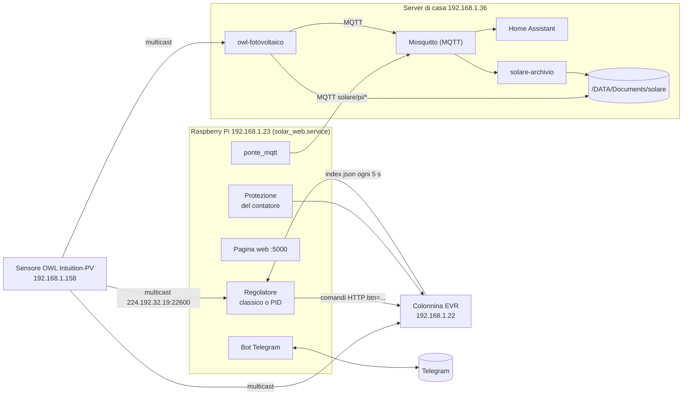

# Regolatore di potenza della ricarica

Carica l'auto elettrica con il sole di casa. Un Raspberry Pi legge ogni pochi
secondi quanto produce l'impianto fotovoltaico e quanto consuma la casa, e
regola di conseguenza la potenza della colonnina EVR. Si può concedere all'auto
una quota di rete (per esempio per caricare di notte), senza mai far saltare il
contatore. Si controlla da una pagina web e da Telegram, e i dati finiscono in
Home Assistant e in un archivio al minuto sul server di casa.

Stato al 9 novembre 2026: sul Pi gira il branch `main`, con l'algoritmo
**classico** attivo.

---

## 1. L'impianto in breve



| Componente | Indirizzo | Cosa fa |
|---|---|---|
| Sensore OWL Intuition-PV | 192.168.1.158 | Misura con pinze amperometriche consumo e produzione, fase per fase, e li trasmette in multicast sulla rete di casa |
| Raspberry Pi | 192.168.1.23 | Fa girare `solar_web.service`: regolatore, protezione del contatore, pagina web, bot Telegram, invio dati al server |
| Colonnina EVR 3 W | 192.168.1.22 | Carica l'auto alla potenza che le diciamo. Si comanda via HTTP (`index.json`) |
| Server di casa ("serverbello") | 192.168.1.36 | Mosquitto e Home Assistant in Docker, il demone `owl-fotovoltaico`, il servizio `solare-archivio` e l'archivio dei dati |
| Telegram | | Comandi e notifiche (bot privato, risponde solo alla chat configurata) |

Due catene indipendenti:

- **Regolazione** (Pi, colonnina): non dipende dal server. Se il server è
  spento, l'auto carica lo stesso.
- **Dati in Home Assistant** (server): produzione, consumi e rete li ascolta
  il server direttamente dal sensore OWL. Se il Pi è spento, la dashboard
  Energia funziona lo stesso; mancano solo i dati della ricarica.

---

## 2. Le misure: il sensore OWL

Il sensore manda due tipi di pacchetti XML in multicast (`224.192.32.19:22600`):

| Pacchetto | Ogni quanto | Contenuto |
|---|---|---|
| `solar` | 6 s di giorno, circa 1 al minuto di notte | Produzione istantanea (`generating`), `exporting`, contatori del giorno (prodotto, esportato) |
| `electricity` | 60 s, 1 s dopo un `solar` | Sei canali, ciascuno istantaneo e contatore del giorno: 0-2 consumo L1-L3, 3-5 produzione L1-L3 |

Conseguenze per la regolazione:

- **Lo scambio netto con la rete si conosce davvero solo ogni 60 s**, dal
  pacchetto `electricity`. Un carico che si accende in casa si vede al
  massimo un minuto dopo.
- `exporting` non è lo scambio netto. È la somma delle sole fasi che
  esportano, media dei 6 s precedenti. Il contatore di casa invece fa la
  somma algebrica delle tre fasi. Il PID lo usa solo per correggere la sua
  stima.
- Il consumo misurato comprende l'auto. La "casa" il regolatore la ricava
  togliendo la potenza della colonnina.
- Il sensore azzera i contatori del giorno a mezzanotte **UTC**, cioè alle
  01:00 italiane. Ogni tanto si riavvia: manda produzione 0 e un timestamp
  strano, e il pacchetto viene scartato.
- Anche la colonnina ascolta il sensore: se il sensore sparisce, va in
  modalità `Alone`.

---

## 3. La colonnina EVR

Si legge e si comanda con richieste HTTP a `http://192.168.1.22/index.json`.
Il dettaglio completo è in [API_CENTRALINA.md](API_CENTRALINA.md).

| Comando | Effetto |
|---|---|
| `?btn=P<watt>` | Imposta la potenza (setpoint). Ha effetto solo in modalità `Man` (`alg=2`) |
| `?btn=i` / `?btn=o` | Accende / spegne la ricarica |
| `?btn=L<kWh>` | Limite di energia da caricare. `L0` lo disattiva |

Campi letti ogni 5 s: `pcar` (potenza dell'auto, in pratica l'eco del
setpoint), `status`/`desc` (auto collegata, in carica, ferma), `tfase`
(monofase o trifase), `pwmin`/`pwmax`, `limit`, `energy` (Wh della sessione:
il segno dice solo se è misurata o stimata), `tplug` (temperatura della
presa), `alg`.

Comportamenti scoperti sul campo:

- **Limiti di potenza:** monofase 1380-7360 W, con la wallbox su L1; trifase
  4140-22000 W.
- **Assorbimento:** l'auto assorbe circa il 90% del setpoint. Quella di casa
  arriva al massimo a ~11 kW anche con 22 kW concessi (limite del suo
  caricatore di bordo).
- **Riaccensione:** quando torna alimentata, la colonnina **riparte da sola**
  alla potenza minima. Il Pi se ne accorge e "adotta" la carica.
- **Pause e cambi di fase da sola:** può mettere in pausa l'auto ("Potenza
  disponibile insufficiente") e può passare da sola da trifase a monofase.
- **Limite kWh:** non è ancora verificato se conta dall'inizio della sessione
  della colonnina (`energy`, che può comprendere cariche precedenti) o dal
  momento in cui lo si imposta.

---

## 4. Il regolatore sul Raspberry

File principali:

| File | Cosa contiene |
|---|---|
| `solar_webinterface.py` | Il servizio: lettura del sensore, algoritmo classico, colonnina, pagina web, bot Telegram, storico, sessioni |
| `regolatore_pid.py` | L'algoritmo PID e lo stimatore dello scambio ogni 6 s. Senza dipendenze esterne, lo usa anche il simulatore |
| `protezione_contatore.py` | Prelievo concesso e protezione del contatore. Senza dipendenze esterne |
| `ponte_mqtt.py` | Invio dei dati al server (Home Assistant e archivio) |
| `simulatore_regolatore.py` | Prova gli algoritmi sul PC con i dati veri (sezione 7) |
| `API_CENTRALINA.md` | Come funziona la colonnina, ricavato dal suo firmware |
| `comandi.txt` | Comandi utili da lanciare sul Pi |
| `solaar_eric.py` | La prima versione dello script, tenuta come riferimento |

### 4.1 Come è organizzato il servizio

Un solo processo Python (`solar_web.service`, avviato da systemd con
`Restart=always`) con più thread:

- **Ciclo principale:** riceve i pacchetti del sensore e a ogni pacchetto
  chiama `run_logic`, che decide la potenza.
- **Thread periodico**, ogni 5 s:
  - legge la colonnina: potenza, fase, limite kWh, inizio e fine delle
    sessioni, temperatura della presa;
  - adotta una carica partita senza di noi;
  - ogni 60 s salva storico e contatori su disco;
  - ogni 60 s controlla che il sensore sia vivo (allarme dopo 5 minuti senza
    pacchetti);
  - alle 23 manda il riepilogo della giornata su Telegram.
- **Pagina web** (Flask, porta 5000).
- **Bot Telegram** (polling), più un thread che spedisce le notifiche in coda
  ed evita i doppioni.
- **Ponte MQTT** (thread di paho-mqtt).

Fermato da systemd (SIGTERM), il servizio salva tutto e **non spegne la
ricarica**. All'avvio, se l'auto sta già caricando, adotta la carica invece di
interromperla.

### 4.2 Un passo di regolazione (`run_logic`)

A ogni pacchetto, in quest'ordine:

1. Il PID osserva sempre, anche quando comanda il classico. Così, se si cambia
   algoritmo, è già pronto.
2. **Protezione del contatore** (4.6). Se interviene, il pacchetto finisce qui.
3. Se è attivo l'override manuale (`/spegni` da Telegram), non si fa nulla.
4. L'algoritmo scelto decide: il **classico** a ogni pacchetto, il **PID**
   solo sui pacchetti `solar`.

### 4.3 Quanto può prendere l'auto: prelevabile e limite del contatore

- `POTENZA_PRELEVABILE` è quanto **l'auto** può prendere dalla rete, **in
  aggiunta** a quello che preleva già la casa.
- Il prelievo totale (casa + auto - sole) non supera mai
  `LIMITE_CONTATORE - MARGINE_CONTATORE` (6600 - 300 = 6300 W).

```
prelievo totale concesso = min( PRELEVABILE + max(0, casa - sole),  6600 - 300 )
```

Esempio di notte, con prelevabile 3000 W:

| Casa | Auto | Prelievo dalla rete |
|---|---|---|
| 0,5 kW | 3 kW | 3,5 kW |
| 3 kW | 3 kW | 6 kW |
| 4,5 kW | 1,8 kW | 6,3 kW (l'auto cede) |
| 5,5 kW | spenta (1,38 kW di minimo non ci stanno) | 5,5 kW |

Con prelevabile 0 l'auto carica solo con il sole in più rispetto alla casa.
In trifase il minimo della colonnina è 4140 W: di notte con un prelevabile
più basso l'auto non parte.

Fino al 3/11/2026 il prelevabile era il totale, casa compresa. Il campo
`prelevabile_w` nell'archivio cambia significato da quella data.

### 4.4 Algoritmo classico

La logica storica, in `run_logic`:

- **Bilancio:** potenza disponibile = sole + prelievo concesso; consumo = il
  consumo totale dell'ultimo pacchetto `electricity`.
- **Accensione:** se l'auto è spenta, la accende al minimo quando
  l'eccedenza supera il minimo della colonnina.
- **Discesa:** se si consuma più del disponibile, scende di quanto serve.
- **Salita:** se avanza potenza, sale lasciando 100 W di margine. Non sale se
  l'auto sta già assorbendo almeno 1,5 kW meno del setpoint (è al suo
  massimo).
- **Spegnimento:** se non basta nemmeno il minimo, la tiene al minimo per
  60 s (`TIMER_SPEGNIMENTO`), poi la spegne se si importano ancora più di
  200 W. Dopo uno spegnimento aspetta 60 s prima di riaccendere.
- **Filtri sui comandi:** non invia variazioni sotto `POTENZA_PROTEZIONE`
  (300 W), al massimo un comando ogni 5 s, e smorza le variazioni.

Limite noto: fra un pacchetto `electricity` e l'altro il classico lavora su un
consumo vecchio fino a 60 s. Durante i 60 s al minimo resta al minimo anche se
il sole torna.

### 4.5 Algoritmo PID (sperimentale)

`regolatore_pid.py`. Decide a ogni pacchetto `solar` (6 s):

- **Stima dello scambio:** stima lo scambio con la rete fase per fase, con la
  casa dell'ultimo `electricity`, il sole fresco e la correzione da
  `exporting`.
- **Taratura:** `PID_KP` 0,1, `PID_KI` 0,15, `PID_MARGINE` 300 W di riserva.
- **Salita e discesa:** sale al massimo di 1 kW ogni 6 s, ma scende subito.
  Non concede più di 1 kW sopra quanto l'auto assorbe davvero.
- **Spegnimento:** decide sulla media della finestra di 60 s.

Nel simulatore sfrutta un po' meglio il sole variabile e accende la colonnina
quasi la metà delle volte. Sul campo, a sole stabile, i due algoritmi sono
risultati pari. Si cambia da Telegram con `/algoritmo pid` o
`/algoritmo classico`, senza riavviare.

### 4.6 Protezione del contatore

`protezione_contatore.py`. Il contatore ha 6 kW di contratto e
`LIMITE_CONTATORE` = 6600 W (+10%). A ogni pacchetto si stima il prelievo:

- al pacchetto `electricity` è quello misurato;
- in mezzo si usano la casa misurata, il sole fresco e i comandi inviati nel
  frattempo.

Se supera 6600 W:

- l'auto viene ridotta **subito**, senza filtri né timer, fino a 6300 W di
  prelievo totale;
- se anche al minimo si supererebbe 6600 W, viene **spenta**;
- fino al pacchetto `electricity` successivo nessun algoritmo può rialzarla;
- arriva una notifica ⚡ su Telegram.

Il limite che resta è il sensore: un carico acceso in casa si vede fino a
60 s dopo. Secondo i manuali dei contatori elettronici non è un problema. Il
contatore stacca in circa 2 minuti solo oltre il 27% in più (circa 8,4 kW);
fra 6,6 e 8,4 kW regge circa 3 ore. Nelle prove sulle sere vere l'auto non
aggiunge distacchi a quelli che la casa farebbe da sola.

### 4.7 Limite di energia (kWh)

- **Come si imposta:** dalla pagina web (cursore e pulsante "Attiva/Disattiva
  limite", oppure "Salva impostazioni") o con `/limite <kWh>`. Il Pi manda
  `L<kWh>` e rilegge per verificare.
- **Lo stato mostrato:** è sempre quello **letto dalla colonnina**. Se la
  colonnina non risponde, il limite risulta "sconosciuto".
- **Se cambia senza il Pi** (dal pannello della colonnina, o perché è stata
  spenta e riaccesa): il Pi lo scrive nel log e lo adotta. Se un limite
  attivo sparisce, arriva un avviso su Telegram.
- **Attenzione:** all'avvio del servizio (riavvio, deploy, "Re-inizializza
  wallbox", `/reset`) un limite attivo viene **disattivato**. Dopo un riavvio
  va rimesso.

### 4.8 Sessioni, contatori ed energia

- **Sessione di ricarica:** inizia quando la colonnina segnala potenza (`pcar`
  > 0) e finisce quando torna a 0, anche se è l'auto a fermarsi da sola.
- **Contatori del giorno:** integrano le potenze di ogni minuto: sole,
  prelievo, immissione, auto, auto dal sole, minuti di carica. Si salvano in
  `stato_energia.json` e ripartono dopo un riavvio.
- **kWh in auto:** sono una **stima** basata sul setpoint, perché la colonnina
  non misura. L'auto assorbe circa il 10% in meno, quindi la stima è un po'
  abbondante.
- **Risparmio:** `PREZZO_ACQUISTO` meno `PREZZO_VENDITA` per i kWh caricati
  dal sole.

### 4.9 Pagina web

`http://192.168.1.23:5000`. Mostra:

- sole, consumi per fase e stato della colonnina;
- grafico dell'ultima ora e dello storico;
- energia di oggi, sessioni, storico giornaliero;
- console dei log;
- impostazioni: prelevabile per l'auto, soglia di protezione, limite kWh,
  prezzi.

Le modifiche valgono solo dopo "Salva impostazioni". Finché ce ne sono di non
salvate, compare un avviso rosso. Il pulsante del limite salva anche le altre
modifiche in sospeso.

| Indirizzo | Cosa fa |
|---|---|
| `GET /api/data` | Stato attuale, configurazione, ultima ora (la pagina lo chiede ogni 2 s) |
| `GET /api/storico` | Storico per i grafici |
| `GET /api/giorni`, `GET /api/sessioni` | Storico giornaliero e sessioni |
| `POST /api/settings` | Salva le impostazioni (tutto o niente) e invia il limite |
| `POST /api/limite_toggle` | Attiva/disattiva il limite kWh |
| `POST /api/init_wallbox` | Re-inizializza la colonnina |
| `GET /api/wallbox_raw` | JSON grezzo della colonnina, per diagnosi |

### 4.10 Telegram

| Comando | Cosa fa |
|---|---|
| `/info` | Stato del sistema, della colonnina e del limite |
| `/energia`, `/storico [giorni]`, `/sessioni` | Energia di oggi, ultimi giorni, ultime sessioni |
| `/grafici [15m\|1h\|6h\|24h]` | Grafico dell'andamento |
| `/fase` | Rilegge subito monofase/trifase |
| `/accendi`, `/spegni` | Forza accensione/spegnimento. Dopo `/spegni` il regolatore non riaccende finché non arriva `/accendi` |
| `/reset` | Re-inizializza la colonnina |
| `/prelevabile <W>`, `/protezione <W>` | Prelevabile per l'auto, soglia di protezione |
| `/limite <kWh>` | Limite di energia |
| `/algoritmo [classico\|pid]`, `/pid ...` | Scelta e taratura dell'algoritmo |

Notifiche automatiche:

- **Avvio e riepilogo:** avvio del sistema, riepilogo alle 23.
- **Auto e colonnina:** auto collegata o scollegata, cambio fase, colonnina
  non raggiungibile o non in modalità `Man`.
- **Potenza:** potenza massima raggiunta, carica spenta per poco sole,
  intervento del limite del contatore ⚡.
- **Allarmi:** sensore muto da 5 minuti, presa a 60 °C (attenzione) o 70 °C
  (allarme), limite kWh sparito dalla colonnina.

### 4.11 Configurazione

In cima a `solar_webinterface.py` c'è il dizionario `CONFIG`. Le voci
modificabili dall'utente vengono salvate in `config_utente.json` e ricaricate
all'avvio:

- `POTENZA_PRELEVABILE`, `POTENZA_PROTEZIONE`, `LIMITE_KWH`;
- `PREZZO_ACQUISTO`, `PREZZO_VENDITA`;
- `ALGORITMO`, `PID_KP`, `PID_KI`, `PID_KD`, `PID_MARGINE`.

Le altre restano nel codice. Le più importanti:

| Voce | Valore | Significato |
|---|---|---|
| `LIMITE_CONTATORE` / `MARGINE_CONTATORE` | 6600 / 300 W | Limite del contatore e margine di regolazione (0 = protezione spenta) |
| `TIMER_SPEGNIMENTO` | 60 s | Quanto si resta al minimo prima di spegnere |
| `COOLDOWN_ACCENSIONE` | 60 s | Attesa minima fra spegnimento e riaccensione |
| `INTERVALLO_SYNC_FASE` | 5 s | Ogni quanto si legge la colonnina |
| `TEMP_PRESA_ATTENZIONE` / `ALLARME` | 60 / 70 °C | Soglie della temperatura della presa |
| `ADOTTA_CARICA_IN_CORSO` | True | All'avvio non interrompe una carica in corso |
| `ORA_RIEPILOGO` | 23 | Ora del riepilogo su Telegram |

Il file `.env` (non versionato) contiene `API_KEY` e `CHAT_ID` del bot
Telegram e `MQTT_HOST`, `MQTT_PORT`, `MQTT_USER`, `MQTT_PASSWORD` per il
server.

### 4.12 File sul Pi

Cartella `/home/tressilloide/solar/regolatore-potenza-carica`:

| File | Contenuto |
|---|---|
| `config_utente.json` | Impostazioni salvate dall'utente |
| `storico.jsonl` | Un campione al minuto `[ts, consumo, produzione, auto]`, ultimi 7 giorni |
| `storico_giornaliero.json` | Totali di ogni giorno |
| `sessioni.json` | Ultime 200 sessioni di ricarica |
| `stato_energia.json` | Contatori di oggi, per ripartire dopo un riavvio |
| `venv/` | L'ambiente Python del servizio |

---

## 5. Dati verso Home Assistant e archivio sul server

### 5.1 Dal Pi: `ponte_mqtt.py`

Il Pi pubblica su Mosquitto del server (192.168.1.36:1883, utente
`solare_pi`), con QoS 1:

| Topic | Contenuto |
|---|---|
| `solare/pi/online` | `online` / `offline` (retained, ultimo messaggio automatico se il Pi sparisce) |
| `solare/pi/stato` | Un JSON al minuto, subito dopo ogni `electricity` (retained) |
| `solare/pi/sessione` | L'ultima sessione di ricarica chiusa (retained) |
| `homeassistant/device/colonnina_pi/config` | Annuncio automatico per Home Assistant (MQTT Discovery) |

Il JSON al minuto contiene:

- **auto e colonnina:** `auto_w`, `setpoint_w`, `pcar_w`, stato della
  colonnina, fase, algoritmo, `prelevabile_w`, kWh della sessione;
- **sole e rete come li vede il Pi:** `produzione_w`, `consumo_w`,
  `prelievo_w`, le sei fasi, e media/minimo/massimo della produzione nel
  minuto;
- **contatori di oggi** del Pi e del sensore OWL.

Se il server non risponde, i messaggi restano in coda sul Pi (fino a una
settimana) e partono alla riconnessione.

In Home Assistant compare il dispositivo **Colonnina**:

| Entità | Cosa |
|---|---|
| `sensor.colonnina_potenza` | Potenza dell'auto (W) |
| `sensor.colonnina_stato` | Stato della colonnina |
| `sensor.colonnina_algoritmo` | Algoritmo attivo (diagnostica) |
| `sensor.colonnina_in_auto_oggi` | kWh in auto oggi |
| `sensor.colonnina_in_auto_dal_sole_oggi` | kWh in auto dal sole oggi |
| `sensor.colonnina_minuti_di_carica_oggi` | Minuti di carica oggi |
| `sensor.colonnina_ultima_sessione` | kWh dell'ultima sessione, con i dettagli negli attributi |

Senza aggiornamenti per 5 minuti i sensori diventano "non disponibili".

### 5.2 Sul server: `owl-fotovoltaico`

Demone Python (`/usr/local/bin/owl-fotovoltaico`, servizio systemd
`owl-fotovoltaico.service`, utente `tressilloide`). Ascolta **direttamente**
il multicast del sensore OWL, senza passare dal Pi.

- A ogni `electricity` usa i contatori del giorno del sensore per calcolare
  l'energia del minuto. Prelievo e immissione sono il **netto delle tre
  fasi**, come li conta il contatore di casa.
- Tiene i totali per sempre e quelli di oggi (mezzanotte italiana) in
  `/DATA/Documents/solare/owl/contatori.json`. Se il demone si ferma,
  l'incremento dei contatori del sensore copre il buco.
- Pubblica in Home Assistant il dispositivo **Fotovoltaico**, 19 sensori:

| Gruppo | Entità |
|---|---|
| Potenze (W) | `sensor.fotovoltaico_produzione`, `_consumo`, `_prelievo_dalla_rete` (negativo = immissione), `_consumo_l1..l3`, `_produzione_l1..l3` |
| Energia per sempre (kWh) | `sensor.fotovoltaico_energia_prodotta`, `_energia_consumata`, `_energia_prelevata`, `_energia_immessa` |
| Energia di oggi (kWh) | `sensor.fotovoltaico_prodotta_oggi`, `_consumata_oggi`, `_prelevata_oggi`, `_immessa_oggi` |
| Diagnostica | `sensor.fotovoltaico_segnale_sensore`, `_batteria_sensore` |

### 5.3 Sul server: `solare-archivio`

Servizio (`/usr/local/bin/solare-archivio`) che con `mosquitto_sub` (sessione
persistente, QoS 1) scrive su disco tutto ciò che pubblica il Pi. Se il
servizio è fermo, Mosquitto conserva fino a 1000 messaggi (circa 16 ore).

Archivio in `/DATA/Documents/solare` (circa 1 MB al mese):

| Percorso | Scritto da | Contenuto |
|---|---|---|
| `owl/AAAA-MM.jsonl` | owl-fotovoltaico | Un JSON al minuto: potenze per fase, energia del minuto, contatori del sensore, totali, segnale e batteria |
| `owl/contatori.json` | owl-fotovoltaico | Totali del demone. Non cancellarlo: si ripartirebbe da zero |
| `pi/AAAA-MM.jsonl` | solare-archivio | Il JSON al minuto del Pi (5.1) |
| `sessioni.jsonl` | solare-archivio | Una riga per sessione di ricarica |
| `pregresso-dal-pi-20261028/` | copia una tantum | Storico del Pi prima del 28/10/2026. Fino a quel giorno i suoi contatori sottostimavano di circa il 14% |

In Python: `pandas.read_json('owl/2026-11.jsonl', lines=True)`.

### 5.4 Home Assistant

Home Assistant 2025.11 in Docker, configurazione in
`/DATA/AppData/homeassistant/config`.

- **Dashboard Energia:**
  - rete = `sensor.fotovoltaico_energia_prelevata` e `_energia_immessa`;
  - solare = `sensor.fotovoltaico_energia_prodotta`;
  - dispositivo "Auto elettrica" = `sensor.colonnina_in_auto_oggi`;
  - prezzi: acquisto 0,25 €/kWh, vendita 0,40 €/kWh;
  - i dati partono dal 28/10/2026; i primi valori arrivano con fino a 2 ore
    di ritardo.
- **Panoramica**, vista Casa: in fondo c'è la sezione Fotovoltaico, con kWh
  prodotti oggi, kWh in auto e quota presa dal sole. Toccando il titolo si
  apre la dashboard Energia.
- **Quanto conserva:** gli stati grezzi 10 giorni; le statistiche a lungo
  termine (medie orarie delle potenze, somme delle energie) per sempre.

### 5.5 Credenziali (dove stanno, mai qui)

- Bot Telegram e utente MQTT del Pi (`solare_pi`): nel `.env` del Pi.
- Utente MQTT dei servizi del server (`solare_archivio`): in
  `/etc/solare/mosquitto_sub` e `/etc/solare/mosquitto_pub` (permessi 600).
- Utenti di Mosquitto: `password.txt` del container Mosquitto.

La descrizione completa del server è in `/mnt/nas-hdd/backups/SERVER.md`
(capitolo 17). Le istruzioni per i servizi del fotovoltaico, compreso come
toglierli, sono in `~/homelab-staging/solare/LEGGIMI.md` sul server.

---

## 6. Deploy e manutenzione

Il Pi ha la stessa cartella git del repo, sul branch `main`. Si accede con
`ssh -i ~/.ssh/solarpi -o IdentitiesOnly=yes tressilloide@192.168.1.23`.

Deploy dal PC senza passare da GitHub:

```sh
# dal PC (Git Bash)
GIT_SSH_COMMAND="ssh -i ~/.ssh/solarpi -o IdentitiesOnly=yes" \
  git push ssh://tressilloide@192.168.1.23/home/tressilloide/solar/regolatore-potenza-carica main:tmp/main

# sul Pi
cd /home/tressilloide/solar/regolatore-potenza-carica
git merge --ff-only tmp/main && git branch -D tmp/main
./venv/bin/python3 -m py_compile solar_webinterface.py regolatore_pid.py protezione_contatore.py ponte_mqtt.py
sudo systemctl restart solar_web.service
```

In alternativa, sul Pi, `git pull` da GitHub. Si lavora anche direttamente sul
Pi: prima di fondere un branch, controllare che `main` non sia andato avanti.

### Dal server di casa (192.168.1.36)

Sul server c'è un clone del progetto in
`/DATA/Documents/claude/regolatore-potenza-carica`, per lavorarci anche con
Claude Code direttamente da lì:

```sh
ssh tressilloide@192.168.1.36
cd /DATA/Documents/claude/regolatore-potenza-carica
claude
```

**Accesso al Pi.** Dal server si entra nel Pi con `ssh pi`, senza password:

| Dove | Cosa |
|---|---|
| Server, `~/.ssh/solarpi` | Chiave privata dedicata (ed25519, senza passphrase) |
| Server, `~/.ssh/config` | Alias `pi` (anche `solarpi`, `raspberry`): 192.168.1.23, utente `tressilloide`, chiave `~/.ssh/solarpi` |
| Server, `~/.ssh/known_hosts` | Chiave host del Pi, impronta `SHA256:HnqQm701gsT5UHn+DeXDaLlQvMNa8QbXwkV7VYOl514` |
| Pi, `~/.ssh/authorized_keys` | Chiave pubblica del server, riga con il commento `serverbello-claude` |

Sul Pi `sudo` non chiede password, quindi da lì si può anche riavviare il
servizio. Prove rapide dal server:

```sh
ssh pi 'hostname; systemctl is-active solar_web.service'
ssh pi 'journalctl -u solar_web.service -n 30 -o cat'
```

Per revocare l'accesso del server basta togliere dal Pi la riga
`serverbello-claude` in `~/.ssh/authorized_keys`.

**Deploy dal server.** Nel clone c'è il remote git `pi`, che punta alla
cartella del progetto sul Pi:

```sh
# sul server, nella cartella del clone
git push pi main:tmp/main
ssh pi 'cd /home/tressilloide/solar/regolatore-potenza-carica \
  && git merge --ff-only tmp/main && git branch -D tmp/main \
  && ./venv/bin/python3 -m py_compile solar_webinterface.py regolatore_pid.py protezione_contatore.py ponte_mqtt.py'
ssh pi 'sudo systemctl restart solar_web.service'
```

Da sapere sul clone del server:

- **Commit:** git non ha ancora nome ed email configurati (`git config
  user.name` / `user.email`).
- **GitHub:** per fare push su GitHub servono credenziali, per esempio
  `gh auth login` o un token.
- **Configurazione sul server:** la descrizione completa è in
  `/mnt/nas-hdd/backups/SERVER.md`, capitoli 13 e 17.

Dopo un riavvio:

- la carica in corso continua;
- il limite kWh viene disattivato. Si rimette dalla pagina web oppure con
  `curl "http://192.168.1.22/index.json?btn=L8"`.

Comandi utili sul Pi (altri in `comandi.txt`):

```sh
journalctl -u solar_web.service -f -o cat          # log in diretta
systemctl status solar_web.service                 # stato del servizio
curl -s http://192.168.1.22/index.json             # stato grezzo della colonnina
```

Sul server:

```sh
systemctl status owl-fotovoltaico solare-archivio
tail -1 /DATA/Documents/solare/owl/$(date +%Y-%m).jsonl
```

Librerie del venv sul Pi: python-telegram-bot 22.7, Flask 3.1, requests,
matplotlib, python-dotenv, paho-mqtt 2.1. Il Pi è un aarch64 con Debian 13.

---

## 7. Simulatore

`simulatore_regolatore.py` prova gli algoritmi sul PC, senza toccare niente.
Usa produzione e consumi veri (`storico.jsonl` del Pi, o l'archivio del
server) e riproduce:

- i pacchetti del sensore (`solar` ogni 6 s, `electricity` ogni 60 s, fase
  per fase);
- la colonnina, con i suoi filtri;
- un'auto che segue il setpoint con un piccolo ritardo, fino al suo massimo;
- carichi brevi casuali in casa.

```sh
python simulatore_regolatore.py storico.jsonl            # classico e PID, giorno per giorno
python simulatore_regolatore.py storico.jsonl --taratura # griglia di parametri del PID
```

Il PID e la protezione del contatore vengono importati dagli stessi file del
Pi. Il classico invece è una **copia** di `run_logic`: se si cambia quello, va
aggiornata anche la copia nel simulatore.

---

## 8. Limiti noti

- **Consumi ogni 60 s:** il consumo per fase arriva una volta al minuto, e
  nessun algoritmo può reagire prima a un carico che si accende.
- **Energia in auto stimata:** i kWh in auto sono stimati dal setpoint; la
  colonnina non ha un contatore.
- **Classico al minimo:** durante i 60 s al minimo non risale anche se torna
  il sole.
- **Limite kWh e riavvii:** ogni riavvio del servizio disattiva il limite kWh.
- **Colonnina spenta la sera:** di notte risulta "non raggiungibile". Quando
  torna alimentata riparte da sola al minimo e il Pi adotta la carica.
