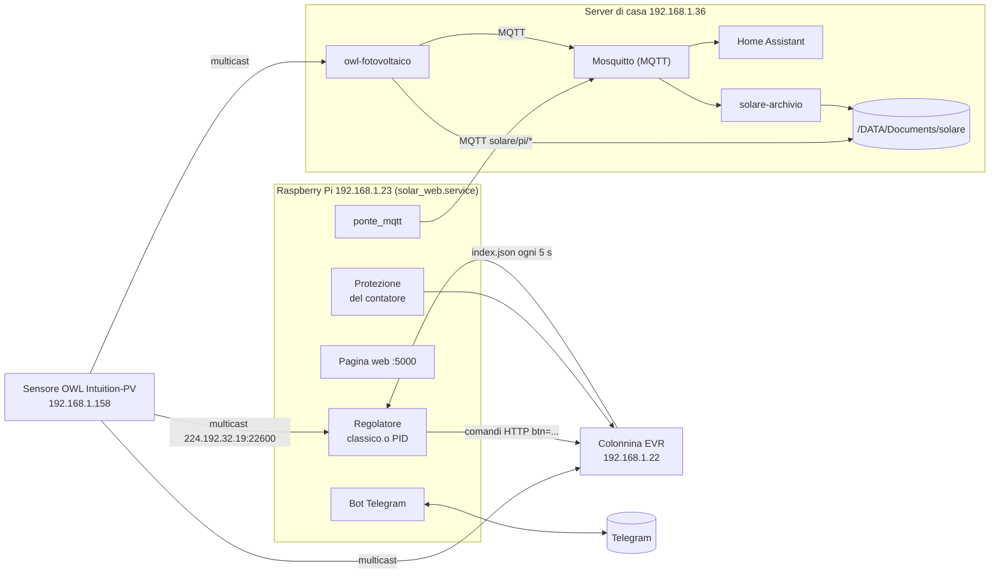

# Regolatore di potenza della ricarica

Carica l'auto elettrica con il sole di casa. Un Raspberry Pi legge ogni pochi
secondi quanto produce l'impianto fotovoltaico e quanto consuma la casa, e
regola di conseguenza la potenza della colonnina EVR. Si può concedere all'auto
una quota di rete (per esempio per caricare di notte), senza mai far saltare il
contatore. Si controlla da una pagina web e da Telegram, e i dati finiscono in
Home Assistant e in un archivio al minuto sul server di casa.

Stato al 10 novembre 2026: sul Pi gira il branch `main`, con l'algoritmo
**classico** attivo e la modalità di carica **Sole + rete**.

---

## 1. L'impianto in breve



| Componente | Indirizzo | Cosa fa |
|---|---|---|
| Sensore OWL Intuition-PV | 192.168.1.158 | Misura con pinze amperometriche consumo e produzione, fase per fase, e li trasmette in multicast sulla rete di casa |
| Raspberry Pi | 192.168.1.23 | Fa girare `solar_web.service`: regolatore, protezione del contatore, pagina web, bot Telegram, invio dati al server |
| Colonnina EVR 3 W | 192.168.1.22 | Carica l'auto alla potenza che le diciamo. Si comanda via HTTP (`index.json`) |
| Server di casa ("serverbello") | 192.168.1.36 | Mosquitto e Home Assistant in Docker, il demone `owl-fotovoltaico`, il servizio `solare-archivio` e l'archivio dei dati |
| Telegram | | Comandi e notifiche (bot privato, risponde solo alla chat configurata) |

Due catene indipendenti:

- **Regolazione** (Pi, colonnina): non dipende dal server. Se il server è
  spento, l'auto carica lo stesso.
- **Dati in Home Assistant** (server): produzione, consumi e rete li ascolta
  il server direttamente dal sensore OWL. Se il Pi è spento, la dashboard
  Energia funziona lo stesso; mancano solo i dati della ricarica.

---

## 2. Le misure: il sensore OWL

Il sensore manda due tipi di pacchetti XML in multicast (`224.192.32.19:22600`):

| Pacchetto | Ogni quanto | Contenuto |
|---|---|---|
| `solar` | 6 s di giorno, circa 1 al minuto di notte | Produzione istantanea (`generating`), `exporting`, contatori del giorno (prodotto, esportato) |
| `electricity` | 60 s, 1 s dopo un `solar` | Sei canali, ciascuno istantaneo e contatore del giorno: 0-2 consumo L1-L3, 3-5 produzione L1-L3 |

Conseguenze per la regolazione:

- **Lo scambio netto con la rete si conosce davvero solo ogni 60 s**, dal
  pacchetto `electricity`. Un carico che si accende in casa si vede al
  massimo un minuto dopo.
- `exporting` non è lo scambio netto. È la somma delle sole fasi che
  esportano, media dei 6 s precedenti. Il contatore di casa invece fa la
  somma algebrica delle tre fasi. Il PID lo usa solo per correggere la sua
  stima.
- Il consumo misurato comprende l'auto. La "casa" il regolatore la ricava
  togliendo la potenza della colonnina.
- Il sensore azzera i contatori del giorno a mezzanotte **UTC**, cioè alle
  01:00 italiane. Ogni tanto si riavvia: manda produzione 0 e un timestamp
  strano, e il pacchetto viene scartato.
- Anche la colonnina ascolta il sensore: se il sensore sparisce, va in
  modalità `Alone`.

---

## 3. La colonnina EVR

Si legge e si comanda con richieste HTTP a `http://192.168.1.22/index.json`.
Il dettaglio completo è in [API_CENTRALINA.md](API_CENTRALINA.md).

| Comando | Effetto |
|---|---|
| `?btn=P<watt>` | Imposta la potenza (setpoint). Ha effetto solo in modalità `Man` (`alg=2`) |
| `?btn=i` / `?btn=o` | Accende / spegne la ricarica |
| `?btn=L<kWh>` | Limite di energia da caricare. `L0` lo disattiva |

Campi letti ogni 5 s: `pcar` (potenza dell'auto, in pratica l'eco del
setpoint), `status`/`desc` (auto collegata, in carica, ferma), `tfase`
(monofase o trifase), `pwmin`/`pwmax`, `limit`, `energy` (Wh della sessione:
il segno dice solo se è misurata o stimata), `tplug` (temperatura della
presa), `alg`.

Comportamenti scoperti sul campo:

- **Limiti di potenza:** monofase 1380-7360 W, con la wallbox su L1; trifase
  4140-22000 W.
- **Assorbimento:** l'auto assorbe circa il 90% del setpoint. Quella di casa
  arriva al massimo a ~11 kW anche con 22 kW concessi (limite del suo
  caricatore di bordo).
- **Riaccensione:** quando torna alimentata, la colonnina **riparte da sola**
  alla potenza minima. Il Pi se ne accorge e "adotta" la carica.
- **Pause e cambi di fase da sola:** può mettere in pausa l'auto ("Potenza
  disponibile insufficiente") e può passare da sola da trifase a monofase.
- **Limite kWh:** non è ancora verificato se conta dall'inizio della sessione
  della colonnina (`energy`, che può comprendere cariche precedenti) o dal
  momento in cui lo si imposta.

---

## 4. Il regolatore sul Raspberry

File principali:

| File | Cosa contiene |
|---|---|
| `solar_webinterface.py` | Il servizio: lettura del sensore, colonnina, API della pagina web, bot Telegram, storico, sessioni |
| `web/` | Le pagine web: il pannello (`index.html`, `app.css`, `app.js`, la scena 3D `scena3d.js`), le statistiche (`statistiche.html`, `.css`, `.js`) e le librerie in `web/vendor/` (4.10, 4.14) |
| `previsione.py` | Previsione del sole dalle statistiche e dal meteo di Home Assistant (4.15). Senza dipendenze esterne |
| `homeassistant/previsione_meteo.yaml` | Pacchetto per Home Assistant che manda al Pi le nuvole previste (4.15) |
| `statistiche.py` | Statistiche di lungo periodo: dai campioni al minuto ai numeri della pagina Statistiche (4.14). Senza dipendenze esterne |
| `regolatore_classico.py` | L'algoritmo classico. Senza dipendenze esterne, lo usa anche il simulatore |
| `regolatore_pid.py` | L'algoritmo PID e lo stimatore dello scambio ogni 6 s. Senza dipendenze esterne, lo usa anche il simulatore |
| `protezione_contatore.py` | Prelievo concesso e protezione del contatore. Senza dipendenze esterne |
| `pianificatore.py` | Modalità di carica e obiettivo kWh: decide la quota di rete per l'auto (4.4). Senza dipendenze esterne |
| `test_regolatore.py` | Test automatici (sezione 6) |
| `ponte_mqtt.py` | Invio dei dati al server (Home Assistant e archivio) |
| `simulatore_regolatore.py` | Prova gli algoritmi sul PC con i dati veri (sezione 7) |
| `API_CENTRALINA.md` | Come funziona la colonnina, ricavato dal suo firmware |
| `comandi.txt` | Comandi utili da lanciare sul Pi |
| `solaar_eric.py` | La prima versione dello script, tenuta come riferimento |

### 4.1 Come è organizzato il servizio

Un solo processo Python (`solar_web.service`, avviato da systemd con
`Restart=always`) con più thread:

- **Ciclo principale:** riceve i pacchetti del sensore e a ogni pacchetto
  chiama `run_logic`, che decide la potenza.
- **Thread periodico**, ogni 5 s:
  - legge la colonnina: potenza, fase, limite kWh, inizio e fine delle
    sessioni, temperatura della presa;
  - adotta una carica partita senza di noi;
  - ogni 60 s salva storico e contatori su disco;
  - ogni 60 s controlla che il sensore sia vivo (allarme dopo 5 minuti senza
    pacchetti);
  - alle 23 manda il riepilogo della giornata su Telegram.
- **Pagina web** (Flask, porta 5000).
- **Bot Telegram** (polling), più un thread che spedisce le notifiche in coda
  ed evita i doppioni.
- **Ponte MQTT** (thread di paho-mqtt).

Fermato da systemd (SIGTERM), il servizio salva tutto e **non spegne la
ricarica**. All'avvio, se l'auto sta già caricando, adotta la carica invece di
interromperla.

### 4.2 Un passo di regolazione (`run_logic`)

A ogni pacchetto, in quest'ordine:

1. Il PID osserva sempre, anche quando comanda il classico. Così, se si cambia
   algoritmo, è già pronto.
2. **Protezione del contatore** (4.7). Se interviene, il pacchetto finisce qui.
3. Se è attivo l'override manuale (`/spegni` da Telegram), non si fa nulla.
4. L'algoritmo scelto decide: il **classico** a ogni pacchetto, il **PID**
   solo sui pacchetti `solar`. Entrambi chiedono al pianificatore (4.4)
   quanta rete può prendere l'auto.

### 4.3 Quanto può prendere l'auto: prelevabile e limite del contatore

- La **quota dell'auto** è quanto l'auto può prendere dalla rete, **in
  aggiunta** a quello che preleva già la casa. La decide il pianificatore
  (4.4): nella modalità Sole + rete è `POTENZA_PRELEVABILE`.
- Il prelievo totale (casa + auto - sole) non supera mai
  `LIMITE_CONTATORE - MARGINE_CONTATORE` (6600 - 300 = 6300 W).

```
prelievo totale concesso = min( quota auto + max(0, casa - sole),  6600 - 300 )
```

Esempio di notte, con prelevabile 3000 W:

| Casa | Auto | Prelievo dalla rete |
|---|---|---|
| 0,5 kW | 3 kW | 3,5 kW |
| 3 kW | 3 kW | 6 kW |
| 4,5 kW | 1,8 kW | 6,3 kW (l'auto cede) |
| 5,5 kW | spenta (1,38 kW di minimo non ci stanno) | 5,5 kW |

Con prelevabile 0 l'auto carica solo con il sole in più rispetto alla casa.
In trifase il minimo della colonnina è 4140 W: di notte con un prelevabile
più basso l'auto non parte.

Fino al 3/11/2026 il prelevabile era il totale, casa compresa. Il campo
`prelevabile_w` nell'archivio cambia significato da quella data.

### 4.4 Modalità di carica e obiettivo

`pianificatore.py` decide la **quota dell'auto** (4.3). Il limite del
contatore e la sua protezione (4.7) valgono in ogni caso.

| Modalità | Quota di rete per l'auto |
|---|---|
| **Solo sole** (`sole`) | 0: solo il sole in più rispetto alla casa |
| **Sole + rete** (`misto`) | `POTENZA_PRELEVABILE` (il comportamento di prima) |
| **Preset** (`preset`) | Il prelevabile del preset scelto, e il suo limite di energia sulla colonnina |

- **Preset:** coppie "tanti kW dalla rete, fermati a tanti kWh" (0 kWh =
  senza limite), fino a 8, con un nome. Di serie: *Veloce* (6,6 kW, senza
  limite), *Notte* (4 kW, 20 kWh), *Rabbocco* (3 kW, 10 kWh). Si scelgono e
  si modificano dalla pagina (terzo pulsante della scheda Carica), si
  scelgono anche da Telegram (`/preset`) e da Home Assistant. Scegliendone
  uno il limite va subito alla colonnina; se è spenta resta in attesa e
  parte appena torna. Il prelevabile della modalità Sole + rete non viene
  toccato. Dall'11/11/2026 i preset hanno preso il posto della modalità
  Veloce: `veloce` è ancora accettato come comando e sceglie il preset con
  quel nome.

- **Obiettivo:** "N kWh in auto entro le HH:MM". Si carica col sole
  finché basta. Quando la potenza media necessaria per finire in tempo
  (kWh mancanti / ore rimaste / 0,9) arriva al minimo della colonnina, si
  integra con la rete quanto serve. Da lì l'integrazione resta agganciata,
  con 400 W sopra il minimo, fino all'obiettivo: senza, caricando al minimo
  la potenza necessaria scenderebbe sotto il minimo e l'auto si
  spegnerebbe a ogni giro.
  - L'energia contata è quella del contatore della centralina, la stessa
    del limite kWh e delle sessioni.
  - Raggiunto l'obiettivo, o passata la scadenza, arriva un messaggio su
    Telegram e si torna alla modalità scelta.
  - Si annulla da solo se l'auto viene scollegata.
  - Esempio, trifase (minimo 4140 W), 10 kWh entro le 7:00 impostati alle
    23: fino alle 4:20 circa si aspetta, poi si carica a ~4,5 kW.

- **Sole previsto:** con una previsione (4.15) dai kWh mancanti si toglie
  prima il sole atteso entro la scadenza, contato al 70%: se domani c'è
  sole, stanotte non si compra dalla rete. Si smette di aspettare quando la
  potenza media che servirebbe senza sole supera il 60% di quanto la rete
  può dare all'auto (contatore meno 1 kW di casa): la rete da sola deve
  poter sempre finire in tempo.
- **Programma settimanale:** regole "nei giorni tali, N kWh entro le
  HH:MM" (fino a 10, dalla pagina; `/programma` su Telegram le mostra).
  Senza un obiettivo attivo, la prossima scadenza diventa l'obiettivo da 24
  ore prima. "Salta questa volta" annulla solo quel giorno. Se l'auto viene
  staccata l'obiettivo del programma riparte da zero (anche se era già
  raggiunto: i kWh se ne sono andati con l'auto), mentre uno messo a mano
  si annulla come prima. Se alla scadenza l'auto non ha mai caricato non
  arriva nessun avviso.

Si comanda dalla pagina web (scheda Carica), da Telegram (`/modalita`,
`/preset`, `/obiettivo`) e da Home Assistant (5.1). Obiettivo e programma
sono salvati in `pianificazione.json`, i preset in `config_utente.json`. Il
boost (Veloce a tempo), aggiunto la mattina del 10/11/2026, è stato tolto
lo stesso giorno.

### 4.5 Algoritmo classico

`regolatore_classico.py` (la logica storica di `run_logic`):

- **Bilancio:** potenza disponibile = sole + prelievo concesso; consumo = il
  consumo totale dell'ultimo pacchetto `electricity`.
- **Accensione:** se l'auto è spenta, la accende al minimo quando
  l'eccedenza supera il minimo della colonnina.
- **Discesa:** se si consuma più del disponibile, scende di quanto serve.
- **Salita:** se avanza potenza, sale lasciando 100 W di margine. Non sale se
  l'auto sta già assorbendo almeno 1,5 kW meno del setpoint (è al suo
  massimo).
- **Spegnimento:** se non basta nemmeno il minimo, la tiene al minimo per
  60 s (`TIMER_SPEGNIMENTO`), poi la spegne se si importano ancora più di
  200 W. Dopo uno spegnimento aspetta 60 s prima di riaccendere.
- **Filtri sui comandi:** non invia variazioni sotto `POTENZA_PROTEZIONE`
  (300 W), al massimo un comando ogni 5 s, e smorza le variazioni.
- **Regolazione calma** (`REGOLAZIONE_CALMA`, spenta di serie; dalle
  impostazioni della pagina, `/calma` su Telegram o l'interruttore in Home
  Assistant): limita i cambi di potenza. Con il sole che va e viene il
  classico corregge a ogni pacchetto (l'11/11/2026: sette cambi in 100 s,
  su e giù di 400 W), perché la potenza misurata dell'auto segue il comando
  con qualche secondo di ritardo. In calma un cambio parte solo se vale
  almeno `CALMA_SOGLIA_W` (500 W) e se dall'ultimo sono passati
  `CALMA_INTERVALLO_S` (30 s); i cali grossi (due volte la soglia) passano
  subito, e la protezione del contatore non ne è toccata. Sul simulatore, 9
  giorni: comandi da 9788 a 4567, sole in auto da 448,9 a 444,6 kWh (-1%),
  prelievo in più invariato.

Limite noto: fra un pacchetto `electricity` e l'altro il classico lavora su un
consumo vecchio fino a 60 s. Durante i 60 s al minimo resta al minimo anche se
il sole torna.

### 4.6 Algoritmo PID (sperimentale)

`regolatore_pid.py`. Decide a ogni pacchetto `solar` (6 s):

- **Stima dello scambio:** stima lo scambio con la rete fase per fase, con la
  casa dell'ultimo `electricity`, il sole fresco e la correzione da
  `exporting`.
- **Taratura:** `PID_KP` 0,1, `PID_KI` 0,15, `PID_MARGINE` 300 W di riserva.
- **Salita e discesa:** sale al massimo di 1 kW ogni 6 s, ma scende subito.
  Non concede più di 1 kW sopra quanto l'auto assorbe davvero.
- **Spegnimento:** decide sulla media della finestra di 60 s.

Nel simulatore sfrutta un po' meglio il sole variabile e accende la colonnina
quasi la metà delle volte. Sul campo, a sole stabile, i due algoritmi sono
risultati pari. Si cambia da Telegram con `/algoritmo pid` o
`/algoritmo classico`, senza riavviare.

### 4.7 Protezione del contatore

`protezione_contatore.py`. Il contatore ha 6 kW di contratto e
`LIMITE_CONTATORE` = 6600 W (+10%). A ogni pacchetto si stima il prelievo:

- al pacchetto `electricity` è quello misurato;
- in mezzo si usano la casa misurata, il sole fresco e i comandi inviati nel
  frattempo.

Se supera 6600 W:

- l'auto viene ridotta **subito**, senza filtri né timer, fino a 6300 W di
  prelievo totale;
- se anche al minimo si supererebbe 6600 W, viene **spenta**;
- fino al pacchetto `electricity` successivo nessun algoritmo può rialzarla;
- arriva una notifica ⚡ su Telegram.

Il limite che resta è il sensore: un carico acceso in casa si vede fino a
60 s dopo. Secondo i manuali dei contatori elettronici non è un problema. Il
contatore stacca in circa 2 minuti solo oltre il 27% in più (circa 8,4 kW);
fra 6,6 e 8,4 kW regge circa 3 ore. Nelle prove sulle sere vere l'auto non
aggiunge distacchi a quelli che la casa farebbe da sola.

### 4.8 Limite di energia (kWh)

- **Come si imposta:** dalla pagina web (cursore e pulsante "Attiva/Disattiva
  limite", oppure "Salva impostazioni") o con `/limite <kWh>`. Il Pi manda
  `L<kWh>` e rilegge per verificare.
- **Lo stato mostrato:** è sempre quello **letto dalla colonnina**. Se la
  colonnina non risponde, il limite risulta "sconosciuto".
- **Se cambia senza il Pi** (dal pannello della colonnina, o perché è stata
  spenta e riaccesa): il Pi lo scrive nel log e lo adotta. Se un limite
  attivo sparisce, arriva un avviso su Telegram.
- **Riavvii:** un riavvio del servizio (anche un deploy) lascia il limite
  com'è. Lo disattivano solo "Re-inizializza wallbox" e `/reset`. Fino al
  10/11/2026 lo disattivava anche il riavvio.

### 4.9 Sessioni, contatori ed energia

- **Sessione di ricarica:** inizia quando la colonnina segnala potenza (`pcar`
  > 0) e finisce quando torna a 0, anche se è l'auto a fermarsi da sola.
  Se la colonnina smette di rispondere mentre carica (spenta dal quadro),
  dopo 10 minuti (`SESSIONE_OFFLINE_S`) la sessione si chiude all'ultima
  volta che la si è vista caricare.
- **kWh della sessione:** la somma degli incrementi del contatore `energy`
  della centralina, che regge sia le pause (il contatore non si azzera) sia
  il cavo staccato (si azzera). La quota dal sole la sessione la accumula per
  conto suo: fino al 10/11/2026 veniva dai contatori del giorno, e le
  sessioni a cavallo della mezzanotte uscivano con la quota vuota o
  negativa.
- **Contatori del giorno:** integrano le potenze di ogni minuto: sole,
  prelievo, immissione, auto, auto dal sole, minuti di carica. Si salvano in
  `stato_energia.json` e ripartono dopo un riavvio.
- **kWh in auto:** sono una **stima** basata sul setpoint, perché la colonnina
  non misura. L'auto assorbe circa il 10% in meno, quindi la stima è un po'
  abbondante.
- **Risparmio:** `PREZZO_ACQUISTO` meno `PREZZO_VENDITA` per i kWh caricati
  dal sole.

### 4.10 Pagina web

`http://192.168.1.23:5000`. Dal 10/11/2026 la pagina sta nella cartella
`web/` (prima era una stringa dentro `solar_webinterface.py`) e non carica
nulla da internet: three.js r160 e Chart.js 4.4.1 sono in `web/vendor/`.

- **Scena 3D** in alto: la casa con i pannelli, la colonnina, l'auto e il
  palo della rete.
  - Le palline lungo i cavi sono i flussi veri: quante e quanto veloci
    dipende dai watt; sulla linea della rete il verso dice se si preleva o
    si immette.
  - Sole, luna, luci di casa e nuvole seguono l'ora e la produzione
    (nuvole più fitte quando si produce meno del previsto per quell'ora).
  - L'auto compare solo se è collegata; in carica la presa lampeggia.
  - Si ruota trascinando, doppio clic per tornare alla vista iniziale.
  - Sotto, una frase dice a parole cosa sta succedendo ("L'auto carica a
    5,2 kW, tutta dal sole. Stai immettendo 2,2 kW in rete.").
  - Il pulsante "Vista semplice" la sostituisce con quattro riquadri; lo
    stesso succede da solo se il browser non ha WebGL. I numeri sono
    etichette HTML sopra la scena, quindi ci sono sempre.
- **Carica:** modalità, prelevabile per l'auto (cursore da 0 al limite del
  contatore, con accanto il valore in watt da scrivere a mano), obiettivo
  con barra di avanzamento, limite di energia. Questi comandi valgono
  subito.
- **Oggi:** energia del giorno, quota della ricarica coperta dal sole,
  autoconsumo (quanto del sole è stato usato in casa) e autosufficienza
  (quanta parte dei consumi ha coperto il sole).
- **Andamento:** produzione contro consumi (casa + auto impilati), su 1 ora,
  6 ore, 24 ore o 7 giorni. **Ultimi 14 giorni:** kWh in auto dal sole e
  dalla rete, e kWh prodotti. Ogni grafico ha anche i dati in tabella.
- **Fasi:** consumo e produzione di L1, L2 e L3, sempre visibili sopra gli
  ultimi 14 giorni, con l'età della misura (arriva ogni 60 s).
- **Colonnina**, **sessioni**, **impostazioni** (soglia di protezione e
  prezzi: valgono solo dopo "Salva impostazioni") e il **registro del
  servizio**.
- Tema chiaro, scuro o automatico (pulsante in alto a destra). Si può
  aggiungere alla schermata Home del telefono.
- A pagina nascosta il browser smette di interrogare il Pi.

| Indirizzo | Cosa fa |
|---|---|
| `GET /` e `GET /static/...` | La pagina e i suoi file (`web/`) |
| `GET /api/data` | Stato attuale e configurazione, ogni 2 s. Con `storia=0` senza l'ultima ora di storico, con `log_da=N` solo le righe di registro dopo la numero N |
| `GET /api/storico?range=1h\|6h\|24h\|7g` | Storico per i grafici |
| `GET /api/giorni`, `GET /api/sessioni` | Storico giornaliero e sessioni |
| `POST /api/preset` | Salva l'elenco dei preset: `{"preset": [{"nome", "prelevabile", "limite_kwh"}, ...]}` |
| `POST /api/programma` | Salva il programma settimanale: `{"programma": [{"giorni": [0..6], "ora": "HH:MM", "kwh", "attivo"}, ...]}` (0 = lunedì) |
| `GET /api/previsione` | Sole previsto ora per ora, oggi e domani (4.15) |
| `GET /statistiche` | La pagina Statistiche (4.14) |
| `GET /api/statistiche?periodo=...` | Tutti i numeri della pagina Statistiche per un periodo: `7g`, `30g`, `90g`, `365g`, `anno`, `tutto`, un mese `AAAA-MM`, oppure `da=AAAA-MM-GG&a=AAAA-MM-GG` |
| `GET /api/statistiche.csv?periodo=...` | La tabella dei giorni del periodo, per il foglio di calcolo |
| `POST /api/settings` | Salva le impostazioni (tutto o niente) |
| `POST /api/comando` | `{"nome": "modalita"\|"prelevabile"\|"obiettivo"\|"preset"\|"calma", "valore": ...}`, come i comandi Telegram |
| `POST /api/limite_toggle` | Attiva/disattiva il limite kWh |
| `POST /api/init_wallbox` | Re-inizializza la colonnina |
| `GET /api/wallbox_raw` | JSON grezzo della colonnina, per diagnosi |

Per cambiare la pagina basta modificare i file in `web/` e fare il deploy:
non serve riavviare il servizio (gli indirizzi dei file portano la data di
modifica, quindi il browser prende subito quelli nuovi).

### 4.11 Telegram

| Comando | Cosa fa |
|---|---|
| `/info` | Stato del sistema, della colonnina e del limite |
| `/energia`, `/storico [giorni]`, `/sessioni` | Energia di oggi, ultimi giorni, ultime sessioni |
| `/grafici [15m\|1h\|6h\|24h\|7g]` | Grafico dell'andamento |
| `/fase` | Rilegge subito monofase/trifase |
| `/accendi`, `/spegni` | Forza accensione/spegnimento. Dopo `/spegni` il regolatore non riaccende finché non arriva `/accendi` |
| `/reset` | Re-inizializza la colonnina |
| `/modalita [sole\|misto\|preset]` | Modalità di carica (4.4) |
| `/preset [nome\|numero]` | Elenco dei preset, o ne sceglie uno |
| `/programma` | Il programma settimanale degli obiettivi |
| `/previsione` | Sole previsto per il resto di oggi e per domani (4.15) |
| `/settimana` | La settimana da lunedì a oggi, contro i giorni prima |
| `/calma [on\|off]` | Regolazione calma: limita i cambi di potenza (4.5) |
| `/obiettivo <kWh> <HH:MM>`, `/obiettivo off` | Obiettivo di carica, per esempio `/obiettivo 15 7:30` |
| `/prelevabile <W>`, `/protezione <W>` | Prelevabile per l'auto (modalità Sole + rete), soglia di protezione |
| `/limite <kWh>` | Limite di energia |
| `/algoritmo [classico\|pid]`, `/pid ...` | Scelta e taratura dell'algoritmo |

Notifiche automatiche:

- **Avvio e riepilogo:** avvio del sistema, riepilogo alle 23; la domenica
  alla stessa ora anche il rapporto della settimana (si spegne dalle
  impostazioni della pagina).
- **Auto e colonnina:** auto collegata o scollegata, cambio fase, colonnina
  non raggiungibile o non in modalità `Man`.
- **Potenza:** potenza massima raggiunta, carica spenta per poco sole,
  intervento del limite del contatore ⚡.
- **Pianificazione:** obiettivo raggiunto 🎯 o non raggiunto
  entro la scadenza, obiettivo annullato perché l'auto è stata scollegata.
- **Allarmi:** sensore muto da 5 minuti, presa a 60 °C (attenzione) o 70 °C
  (allarme), limite kWh sparito dalla colonnina.

### 4.12 Configurazione

In cima a `solar_webinterface.py` c'è il dizionario `CONFIG`. Le voci
modificabili dall'utente vengono salvate in `config_utente.json` e ricaricate
all'avvio:

- `POTENZA_PRELEVABILE`, `POTENZA_PROTEZIONE`, `LIMITE_KWH`, `MODALITA`;
- `PRESET` (l'elenco), `PRESET_ATTIVO`;
- `REGOLAZIONE_CALMA`, `CALMA_SOGLIA_W`, `CALMA_INTERVALLO_S`,
  `RAPPORTO_SETTIMANALE`;
- `PREZZO_ACQUISTO`, `PREZZO_VENDITA`;
- `ALGORITMO`, `PID_KP`, `PID_KI`, `PID_KD`, `PID_MARGINE`.

Le altre restano nel codice. Le più importanti:

| Voce | Valore | Significato |
|---|---|---|
| `LIMITE_CONTATORE` / `MARGINE_CONTATORE` | 6600 / 300 W | Limite del contatore e margine di regolazione (0 = protezione spenta) |
| `TIMER_SPEGNIMENTO` | 60 s | Quanto si resta al minimo prima di spegnere |
| `COOLDOWN_ACCENSIONE` | 60 s | Attesa minima fra spegnimento e riaccensione |
| `INTERVALLO_SYNC_FASE` | 5 s | Ogni quanto si legge la colonnina |
| `SESSIONE_OFFLINE_S` | 600 s | Colonnina muta da tanto mentre caricava: la sessione si chiude |
| `TEMP_PRESA_ATTENZIONE` / `ALLARME` | 60 / 70 °C | Soglie della temperatura della presa |
| `ADOTTA_CARICA_IN_CORSO` | True | All'avvio non interrompe una carica in corso |
| `ORA_RIEPILOGO` | 23 | Ora del riepilogo su Telegram |

Il file `.env` (non versionato) contiene `API_KEY` e `CHAT_ID` del bot
Telegram e `MQTT_HOST`, `MQTT_PORT`, `MQTT_USER`, `MQTT_PASSWORD` per il
server.

### 4.13 File sul Pi

Cartella `/home/tressilloide/solar/regolatore-potenza-carica`:

| File | Contenuto |
|---|---|
| `config_utente.json` | Impostazioni salvate dall'utente |
| `storico.jsonl` | Un campione al minuto `[ts, consumo, produzione, auto, L1..L6]`, ultimi 7 giorni (le sei fasi dal 10/11/2026) |
| `statistiche_giorni.jsonl` | L'archivio delle statistiche: una riga per ogni giorno chiuso, per sempre (4.14) |
| `previsioni.jsonl` | La previsione fatta ogni sera per il giorno dopo (4.15) |
| `storico_giornaliero.json` | I vecchi totali di ogni giorno. Dall'11/11/2026 non lo legge più nessuno: "Ultimi 14 giorni" e `/storico` usano l'archivio delle statistiche |
| `sessioni.json` | Ultime 200 sessioni di ricarica |
| `pianificazione.json` | Obiettivo in corso |
| `stato_energia.json` | Contatori di oggi, per ripartire dopo un riavvio |
| `venv/` | L'ambiente Python del servizio |

### 4.15 Previsione del sole

`previsione.py` stima quanto produrrà il tetto nelle prossime ore e quanto
ne resterà per l'auto (prima la casa). Serve all'obiettivo (4.4), e la
pagina la mostra nella scheda Oggi ("Sole previsto").

| Fonte | Come si calcola |
|---|---|
| **meteo** | La produzione di una giornata serena (la seconda ora migliore degli ultimi 14 giorni, dalle statistiche) per un fattore che scende con le nuvole: `1 - 0,75 × nuvole^3,4` |
| **storico** | Senza meteo, o con meteo più vecchio di 9 ore: la media degli ultimi 5 giorni a quell'ora. Sui 47 giorni provati sbaglia in media del 31% sul totale del giorno ("uguale a ieri" sbaglia del 38%) |

In tutti e due i casi le ore che restano di oggi si correggono con quello
che il tetto ha reso finora rispetto al previsto (fra 0,35 e 1,6).

Il meteo arriva da Home Assistant, che ha già le previsioni orarie di
met.no (`weather.forecast_home`): il pacchetto
`homeassistant/previsione_meteo.yaml` le pubblica ogni ora su
`solare/previsione/meteo` (retained). Va copiato in `config/packages/` di
Home Assistant (installato l'11/11/2026 come `solare_previsione.yaml`); se
manca, la previsione resta quella dallo storico. Il Pi non interroga nessun
servizio su internet.

La pagina mostra il sole previsto ora per ora nella scheda Oggi. Ogni sera
alle 20 la previsione per il giorno dopo viene messa da parte in
`previsioni.jsonl`, e la pagina Statistiche (scheda "Il sole") la confronta
con quello che il tetto ha prodotto davvero: è il modo per sapere quanto
fidarsene.

### 4.14 Statistiche

`http://192.168.1.23:5000/statistiche` (dal pannello: l'icona con le tre
barre in alto, o "Tutte le statistiche" nella scheda degli ultimi 14 giorni).
Una pagina sola per tutto lo storico, con un filtro di periodo che vale per
ogni scheda: 7, 30, 90 giorni, l'anno, tutto, un mese preciso, oppure un
giorno solo toccandolo nel calendario.

Cosa mostra: i totali con il confronto sul periodo precedente; il diagramma
dei flussi (sole e rete verso casa, auto e immissione); l'energia nel tempo
per giorno, settimana o mese; la mappa ora per ora; la giornata e la
settimana tipo; il calendario; il sole (curva per mese, ore equivalenti,
CO₂); la casa (carico di fondo, fasi); la rete (tempo a ogni potenza di
prelievo, picchi oltre il contatore); le ricariche (quante, quanto, a che
ora, a che potenza, elenco); i conti in euro; i primati e le strisce.

**Da dove arrivano i numeri.** Tutto è ricavato dai campioni al minuto
(`statistiche.py`), non dai contatori del giorno:

- `aggrega()` trasforma i campioni di un giorno in un record: energia ora
  per ora (prodotta, consumata, in auto, prelevata, immessa, in auto dal
  sole), picchi, minuti passati a ogni potenza, energia per fase, tratti di
  carica. Circa 1 kB al giorno.
- Due minuti dopo mezzanotte (e all'avvio, se manca qualcosa) il servizio
  chiude il giorno prima in `statistiche_giorni.jsonl`. Il giorno in corso
  è ricalcolato dai campioni in memoria, al massimo una volta al minuto.
- `calcola()` fa tutti i conti del periodo richiesto; la pagina disegna
  soltanto. Chilometri, benzina e CO₂ dipendono da quattro ipotesi che si
  cambiano in fondo alla pagina e restano nel browser.

**L'energia in auto.** La potenza dichiarata dalla colonnina non basta
(`auto_reale()`): spenta dal quadro mentre carica resta ferma all'ultimo
valore per ore, e in trifase dichiara i 22 kW concessi quando l'auto ne
prende 11. Il totale misurato dal sensore fa da tetto: dove il dichiarato lo
supera, all'auto va il totale meno la casa; se quel che resta è sotto il
minimo della colonnina l'auto è ferma finché il valore non cambia. Sul
periodo 29/10–9/11 il risultato coincide col contatore della colonnina
(337 kWh contro 346, e la differenza è il contatore che conta 22 kW).
Dal 10/11/2026 anche i contatori del giorno non contano più l'auto quando
la colonnina non risponde da oltre due minuti.

**Ricostruire l'archivio.** I giorni dal 14/9/2026 sono stati ricostruiti
dall'archivio sul server (5.3). Per rifarlo, sul server:

```sh
A=/DATA/Documents/solare
TZ=Europe/Rome python3 statistiche.py importa /tmp/statistiche_giorni.jsonl \
  $A/pi/*.jsonl $A/pregresso-dal-pi-20261028/storico.jsonl
scp /tmp/statistiche_giorni.jsonl pi:solar/regolatore-potenza-carica/
```

`TZ` serve perché il server è in UTC e i giorni sono quelli di casa. Se due
file coprono lo stesso minuto vale il primo elencato. Il servizio rilegge
il file da solo, non serve riavviarlo.

---

## 5. Dati verso Home Assistant e archivio sul server

### 5.1 Dal Pi: `ponte_mqtt.py`

Il Pi pubblica su Mosquitto del server (192.168.1.36:1883, utente
`solare_pi`), con QoS 1:

| Topic | Contenuto |
|---|---|
| `solare/pi/online` | `online` / `offline` (retained, ultimo messaggio automatico se il Pi sparisce) |
| `solare/pi/stato` | Un JSON al minuto, subito dopo ogni `electricity` (retained) |
| `solare/pi/sessione` | L'ultima sessione di ricarica chiusa (retained) |
| `solare/pi/controlli` | Modalità, prelevabile e obiettivo (retained), a ogni cambio e ogni minuto |
| `solare/pi/cmd/<comando>` | **Comandi** verso il Pi, non retained: `modalita` (`sole`/`misto`/`preset`), `preset` (nome), `calma` (`on`/`off`), `prelevabile` (W), `obiettivo` (`15 7:30` o `off`) |
| `homeassistant/device/colonnina_pi/config` | Annuncio automatico per Home Assistant (MQTT Discovery) |

Il JSON al minuto contiene:

- **auto e colonnina:** `auto_w`, `setpoint_w`, `pcar_w`, stato della
  colonnina, fase, algoritmo, `prelevabile_w`, kWh della sessione;
- **pianificazione:** `modalita`,
  `quota_rete_auto_w`, e con un obiettivo `obiettivo_kwh` e
  `obiettivo_fatti_kwh`;
- **sole e rete come li vede il Pi:** `produzione_w`, `consumo_w`,
  `prelievo_w`, le sei fasi, e media/minimo/massimo della produzione nel
  minuto;
- **contatori di oggi** del Pi e del sensore OWL.

Se il server non risponde, i messaggi restano in coda sul Pi (fino a una
settimana) e partono alla riconnessione.

In Home Assistant compare il dispositivo **Colonnina**:

| Entità | Cosa |
|---|---|
| `sensor.colonnina_potenza` | Potenza dell'auto (W) |
| `sensor.colonnina_stato` | Stato della colonnina |
| `sensor.colonnina_algoritmo` | Algoritmo attivo (diagnostica) |
| `sensor.colonnina_in_auto_oggi` | kWh in auto oggi |
| `sensor.colonnina_in_auto_dal_sole_oggi` | kWh in auto dal sole oggi |
| `sensor.colonnina_minuti_di_carica_oggi` | Minuti di carica oggi |
| `sensor.colonnina_ultima_sessione` | kWh dell'ultima sessione, con i dettagli negli attributi |
| `select.colonnina_modalita` | **Comando:** modalità di carica (`sole`, `misto`, `preset`) |
| `select.colonnina_preset` | **Comando:** il preset (i nomi seguono quelli della pagina) |
| `switch.colonnina_regolazione_calma` | **Comando:** regolazione calma |
| `sensor.colonnina_autosufficienza_oggi`, `..._autoconsumo_oggi` | Percentuali della giornata in corso |
| `sensor.colonnina_potenza_libera` | Quanto si può accendere adesso senza prelevare (produzione meno consumi, mai sotto zero): per le automazioni di boiler, lavatrice e simili |
| `sensor.colonnina_carico_di_fondo` | Quel che resta sempre acceso in casa (ultimi 7 giorni) |
| `sensor.colonnina_sole_previsto_oggi_resto`, `..._sole_previsto_domani` | kWh previsti (4.15) |
| `number.colonnina_prelevabile_per_l_auto` | **Comando:** prelevabile per l'auto, 0-6600 W |
| `sensor.colonnina_modalita_attiva` | Modalità in vigore, con l'obiettivo negli attributi |
| `sensor.colonnina_obiettivo_caricato` | kWh caricati per l'obiettivo in corso |

Senza aggiornamenti per 5 minuti i sensori diventano "non disponibili".

Con i comandi Home Assistant può anche automatizzare: per esempio
"preset Veloce quando serve l'auto carica in fretta", o un obiettivo pubblicando su
`solare/pi/cmd/obiettivo`. Il Pi valida ogni comando come quelli di
Telegram, scrive nel log chi l'ha dato (`[HOME ASSISTANT]`) e ignora i
messaggi retained. Mosquitto non ha ACL: qualunque utente del broker può
mandare comandi.

### 5.2 Sul server: `owl-fotovoltaico`

Demone Python (`/usr/local/bin/owl-fotovoltaico`, servizio systemd
`owl-fotovoltaico.service`, utente `tressilloide`). Ascolta **direttamente**
il multicast del sensore OWL, senza passare dal Pi.

- A ogni `electricity` usa i contatori del giorno del sensore per calcolare
  l'energia del minuto. Prelievo e immissione sono il **netto delle tre
  fasi**, come li conta il contatore di casa.
- Tiene i totali per sempre e quelli di oggi (mezzanotte italiana) in
  `/DATA/Documents/solare/owl/contatori.json`. Se il demone si ferma,
  l'incremento dei contatori del sensore copre il buco.
- Pubblica in Home Assistant il dispositivo **Fotovoltaico**, 19 sensori:

| Gruppo | Entità |
|---|---|
| Potenze (W) | `sensor.fotovoltaico_produzione`, `_consumo`, `_prelievo_dalla_rete` (negativo = immissione), `_consumo_l1..l3`, `_produzione_l1..l3` |
| Energia per sempre (kWh) | `sensor.fotovoltaico_energia_prodotta`, `_energia_consumata`, `_energia_prelevata`, `_energia_immessa` |
| Energia di oggi (kWh) | `sensor.fotovoltaico_prodotta_oggi`, `_consumata_oggi`, `_prelevata_oggi`, `_immessa_oggi` |
| Diagnostica | `sensor.fotovoltaico_segnale_sensore`, `_batteria_sensore` |

### 5.3 Sul server: `solare-archivio`

Servizio (`/usr/local/bin/solare-archivio`) che con `mosquitto_sub` (sessione
persistente, QoS 1) scrive su disco tutto ciò che pubblica il Pi. Se il
servizio è fermo, Mosquitto conserva fino a 1000 messaggi (circa 16 ore).

Archivio in `/DATA/Documents/solare` (circa 1 MB al mese):

| Percorso | Scritto da | Contenuto |
|---|---|---|
| `owl/AAAA-MM.jsonl` | owl-fotovoltaico | Un JSON al minuto: potenze per fase, energia del minuto, contatori del sensore, totali, segnale e batteria |
| `owl/contatori.json` | owl-fotovoltaico | Totali del demone. Non cancellarlo: si ripartirebbe da zero |
| `pi/AAAA-MM.jsonl` | solare-archivio | Il JSON al minuto del Pi (5.1) |
| `sessioni.jsonl` | solare-archivio | Una riga per sessione di ricarica |
| `pregresso-dal-pi-20261028/` | copia una tantum | Storico del Pi prima del 28/10/2026. Fino a quel giorno i suoi contatori sottostimavano di circa il 14% |

In Python: `pandas.read_json('owl/2026-11.jsonl', lines=True)`.

### 5.4 Home Assistant

Home Assistant 2025.11 in Docker, configurazione in
`/DATA/AppData/homeassistant/config`.

- **Dashboard Energia:**
  - rete = `sensor.fotovoltaico_energia_prelevata` e `_energia_immessa`;
  - solare = `sensor.fotovoltaico_energia_prodotta`;
  - dispositivo "Auto elettrica" = `sensor.colonnina_in_auto_oggi`;
  - prezzi: acquisto 0,25 €/kWh, vendita 0,40 €/kWh;
  - i dati partono dal 28/10/2026; i primi valori arrivano con fino a 2 ore
    di ritardo.
- **Panoramica**, vista Casa: in fondo c'è la sezione Fotovoltaico, con kWh
  prodotti oggi, kWh in auto e quota presa dal sole. Toccando il titolo si
  apre la dashboard Energia.
- **Quanto conserva:** gli stati grezzi 10 giorni; le statistiche a lungo
  termine (medie orarie delle potenze, somme delle energie) per sempre.

### 5.5 Credenziali (dove stanno, mai qui)

- Bot Telegram e utente MQTT del Pi (`solare_pi`): nel `.env` del Pi.
- Utente MQTT dei servizi del server (`solare_archivio`): in
  `/etc/solare/mosquitto_sub` e `/etc/solare/mosquitto_pub` (permessi 600).
- Utenti di Mosquitto: `password.txt` del container Mosquitto.

La descrizione completa del server è in `/mnt/nas-hdd/backups/SERVER.md`
(capitolo 17). Le istruzioni per i servizi del fotovoltaico, compreso come
toglierli, sono in `~/homelab-staging/solare/LEGGIMI.md` sul server.

---

## 6. Deploy e manutenzione

Il Pi ha la stessa cartella git del repo, sul branch `main`. Si accede con
`ssh -i ~/.ssh/solarpi -o IdentitiesOnly=yes tressilloide@192.168.1.23`.

Deploy dal PC senza passare da GitHub:

```sh
# dal PC (Git Bash)
GIT_SSH_COMMAND="ssh -i ~/.ssh/solarpi -o IdentitiesOnly=yes" \
  git push ssh://tressilloide@192.168.1.23/home/tressilloide/solar/regolatore-potenza-carica main:tmp/main

# sul Pi
cd /home/tressilloide/solar/regolatore-potenza-carica
git merge --ff-only tmp/main && git branch -D tmp/main
./venv/bin/python3 -m py_compile *.py
sudo systemctl restart solar_web.service
```

In alternativa, sul Pi, `git pull` da GitHub. Si lavora anche direttamente sul
Pi: prima di fondere un branch, controllare che `main` non sia andato avanti.

### Dal server di casa (192.168.1.36)

Sul server c'è un clone del progetto in
`/DATA/Documents/claude/regolatore-potenza-carica`, per lavorarci anche con
Claude Code direttamente da lì:

```sh
ssh tressilloide@192.168.1.36
cd /DATA/Documents/claude/regolatore-potenza-carica
claude
```

**Accesso al Pi.** Dal server si entra nel Pi con `ssh pi`, senza password:

| Dove | Cosa |
|---|---|
| Server, `~/.ssh/solarpi` | Chiave privata dedicata (ed25519, senza passphrase) |
| Server, `~/.ssh/config` | Alias `pi` (anche `solarpi`, `raspberry`): 192.168.1.23, utente `tressilloide`, chiave `~/.ssh/solarpi` |
| Server, `~/.ssh/known_hosts` | Chiave host del Pi, impronta `SHA256:HnqQm701gsT5UHn+DeXDaLlQvMNa8QbXwkV7VYOl514` |
| Pi, `~/.ssh/authorized_keys` | Chiave pubblica del server, riga con il commento `serverbello-claude` |

Sul Pi `sudo` non chiede password, quindi da lì si può anche riavviare il
servizio. Prove rapide dal server:

```sh
ssh pi 'hostname; systemctl is-active solar_web.service'
ssh pi 'journalctl -u solar_web.service -n 30 -o cat'
```

Per revocare l'accesso del server basta togliere dal Pi la riga
`serverbello-claude` in `~/.ssh/authorized_keys`.

**Deploy dal server.** Nel clone c'è il remote git `pi`, che punta alla
cartella del progetto sul Pi:

```sh
# sul server, nella cartella del clone
git push pi main:tmp/main
ssh pi 'cd /home/tressilloide/solar/regolatore-potenza-carica \
  && git merge --ff-only tmp/main && git branch -D tmp/main \
  && ./venv/bin/python3 -m py_compile *.py'
ssh pi 'sudo systemctl restart solar_web.service'
```

**Test.** `python3 -m unittest -v test_regolatore` prova pianificatore,
protezione, regolatore classico e statistiche ovunque. I test del servizio (sessioni,
API web, pagina) richiedono le librerie del venv del Pi; sul server non ci
sono (né pip né venv), quindi li si lancia sul Pi in una cartella a parte,
senza toccare il servizio:

```sh
ssh pi 'rm -rf /tmp/prova-regolatore && mkdir /tmp/prova-regolatore'
scp -r *.py web pi:/tmp/prova-regolatore/
ssh pi 'cd /tmp/prova-regolatore && MPLCONFIGDIR=/tmp/prova-regolatore/.mpl \
  /home/tressilloide/solar/regolatore-potenza-carica/venv/bin/python -m unittest -v test_regolatore'
```

Da sapere sul clone del server:

- **Commit e GitHub:** nome ed email di git sono configurati e il push su
  GitHub (`origin`, via SSH) funziona.
- **Configurazione sul server:** la descrizione completa è in
  `/mnt/nas-hdd/backups/SERVER.md`, capitoli 13 e 17.

Dopo un riavvio:

- la carica in corso continua;
- il limite kWh resta com'è sulla colonnina;
- modalità e obiettivo ripartono da dove erano.

Comandi utili sul Pi (altri in `comandi.txt`):

```sh
journalctl -u solar_web.service -f -o cat          # log in diretta
systemctl status solar_web.service                 # stato del servizio
curl -s http://192.168.1.22/index.json             # stato grezzo della colonnina
```

Sul server:

```sh
systemctl status owl-fotovoltaico solare-archivio
tail -1 /DATA/Documents/solare/owl/$(date +%Y-%m).jsonl
```

Librerie del venv sul Pi: python-telegram-bot 22.7, Flask 3.1, requests,
matplotlib, python-dotenv, paho-mqtt 2.1. Il Pi è un aarch64 con Debian 13.

---

## 7. Simulatore

`simulatore_regolatore.py` prova gli algoritmi sul PC, senza toccare niente.
Usa produzione e consumi veri (`storico.jsonl` del Pi, o l'archivio del
server) e riproduce:

- i pacchetti del sensore (`solar` ogni 6 s, `electricity` ogni 60 s, fase
  per fase);
- la colonnina, con i suoi filtri;
- un'auto che segue il setpoint con un piccolo ritardo, fino al suo massimo;
- carichi brevi casuali in casa.

```sh
python simulatore_regolatore.py storico.jsonl            # classico e PID, giorno per giorno
python simulatore_regolatore.py storico.jsonl --taratura # griglia di parametri del PID
```

Classico, PID e protezione del contatore vengono importati dagli stessi
file del Pi. Resta una copia solo dei filtri di `WallboxController._set_power`
(`FintaWallbox`): se si cambiano quelli, va aggiornata anche lì.

Per avere più giorni si può costruire un file nello stesso formato dagli
archivi del server (`pregresso-dal-pi-20261028/storico.jsonl` e
`pi/AAAA-MM.jsonl`), togliendo l'auto dal consumo: a novembre 2026 così si
arrivava a 137 giorni.

---

## 8. Limiti noti

- **Consumi ogni 60 s:** il consumo per fase arriva una volta al minuto, e
  nessun algoritmo può reagire prima a un carico che si accende.
- **Energia in auto stimata:** i kWh in auto vengono dalla potenza dichiarata
  dalla colonnina, corretta col totale del sensore (4.14): è una stima.
- **Statistiche prima del 28/10/2026:** i riepiloghi giornalieri di allora
  (`storico_giornaliero.json`) sottostimano la produzione fino alla metà per
  un difetto poi corretto; la pagina Statistiche usa i campioni al minuto e
  non ne risente. Mancano le letture per fase.
- **Classico al minimo:** durante i 60 s al minimo non risale anche se torna
  il sole.
- **Colonnina spenta la sera:** di notte risulta "non raggiungibile". Quando
  torna alimentata riparte da sola al minimo e il Pi adotta la carica.
